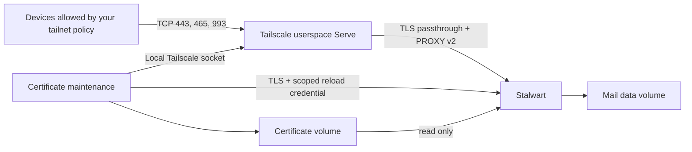

# Security boundaries

The three containers run without privileged mode, a TUN device, host networking,
or host port publications. Only Tailscale has an internet-connected Docker
network. The backend network is internal; mail also has a dedicated resolver
file pointing to loopback so Docker's embedded DNS cannot forward its requests.
Stalwart's own DNS resolver points to loopback. There is no external mail route.

Serve forwards raw TCP with PROXY v2. Stalwart terminates TLS, accepts forwarded
addresses only from the fixed Tailscale backend IPv4 address, and does not trust
HTTP Forwarded/X-Forwarded-For headers. The maintenance HTTPS port 8444 is not
forwarded. The basic setup uses the existing tailnet policy, with no required tags
or custom ACLs. Under Tailscale's default allow-all policy, every tailnet device
can reach HTTPS, SMTP, and IMAP. Application authentication still protects
mailboxes and administration, and directed email peer permissions still apply.
Network-wide reachability lets more devices attempt logins or attack a service.

The [optional access rules](access-control.md) restrict email access to selected
nodes and the entire HTTPS endpoint to administrator nodes, including the API and
login resources needed by `/admin`. Unapproved nodes are denied only if the
**whole tailnet policy** has no other rule covering these destinations. Skipping
these optional rules does not enable public/LAN access or Tailscale Funnel.

Tailnet membership and mailbox authentication are separate requirements. Mailbox
credentials identify the agent; a tailnet node is not automatically bound to a
particular mailbox. For strict node/mailbox binding, set the password credential's
**Allowed IPs** to that node's stable Tailscale IPv4 `/32` and IPv6 `/128` in the
WebUI. PROXY v2 preserves these addresses. The maintenance credential is already
restricted to the maintenance container's backend IP and has only authenticate,
action-create, and TLS-certificate-reload permissions.

Docker host administrators and containers attached by an administrator to the
private backend are inside the trusted boundary. The maintenance socket grants
control of the dedicated Tailscale daemon, not merely certificate issuance;
Tailscale does not provide a certificate-only local socket. Keep its image and
script trusted. Maintenance has no mail-data or mail-configuration mount.

Recovery credentials are freshly generated for each startup, used on an internal
unforwarded port, and removed from the environment before normal service starts.
Recovery output and temporary credential plans remain in a private tmpfs and are
deleted. Initial passwords are not reapplied to existing accounts. Restarting
reasserts the reviewed baseline; use source changes for intentional policy
changes, not ad-hoc WebUI changes that a restart would undo.

TLS certificates are validated for chain trust, hostname, expiration, and key
matching before installation. A generation directory and atomic symlink switch
avoid mixed key/certificate pairs. Renewal/reload failure does not create a
plaintext listener. Mail can continue using its last loaded certificate until a
reload succeeds; clients reject an expired certificate. Health checks detect
expired or invalid mounted certificates. If HTTPS reload is blocked by an expired
loaded certificate, a local watchdog verifies the on-disk replacement and checks
loopback HTTPS with full certificate verification. Only a valid replacement plus
a certificate-verification failure triggers graceful shutdown; Compose restarts
mail to load the replacement through normal bootstrap. This briefly interrupts
connections without adding an endpoint, credentials, capabilities, or a Docker
socket. Invalid replacements never trigger this recovery. Startup waits instead
of falling back to a self-signed or plaintext listener. Tailscale certificates are
checked twice daily; failures retry every five minutes.

Email blobs use Stalwart's AES-256-GCM encryption with a separately mounted random
key. Metadata, indexes, queued data, and running process memory are not covered
by that blob key. Host disk encryption is optional hardening that protects those
files when storage is offline; it is not a startup prerequisite. Encrypting
backups is also recommended because they contain more than encrypted email blobs.
Losing the blob key loses access to encrypted mail. Do not casually replace or
rotate the key file: old blobs require their original key.

The configuration disables spam filtering, Pyzor/DNSBL, ASN/geolocation resource
downloads, public-key harvesting, DMARC/SPF/DKIM/TLS reporting, metrics exporters,
webhooks, and mail filtering hooks. The WebUI is bundled and checksum-verified
at build time. Initial recovery may attempt the upstream default WebUI URL before
the local application entry exists; the mail container has no egress, so this
cannot download anything. Subsequent operation uses the bundled file.

Operational logs contain selected lifecycle, bind, and certificate events only.
They omit message contents, SMTP transcripts, subjects, authentication events,
and credentials. Docker rotates each service's logs at 3 × 5 MiB. Do not enable
debug logging on a production mailbox without reviewing its privacy impact.
Tailscale's diagnostic log upload is disabled with `TS_NO_LOGS_NO_SUPPORT=true`,
following its [client logging opt-out](https://tailscale.com/docs/features/logging).
Its coordination service still receives the metadata needed to operate the VPN.

The ts.net certificate hostname is public in certificate-transparency logs.
Tailscale's coordination/relay services see their normal transport metadata.
Email processed by a cloud-backed agent can reach its model provider under that
provider's policies. Server-side encryption does not change that boundary.

Messages remain untrusted input to agents. Permission to exchange mail is not
permission to execute arbitrary emailed instructions. The supplied agent prompt
includes thread tracking and bounded replies to reduce autonomous reply loops.

The optional local channel bridge uses verified IMAP TLS and a read-only INBOX
selection. It accepts only exact configured sender addresses and suppresses
self-mail. Its notification payload contains identifiers and the allowlisted
sender, not subjects, bodies, or attachments. Stalwart's authenticated sender
checks remain essential: a From allowlist alone is not proof of identity on an
arbitrary mail system. Pending events and cursors are stored in an owner-only
local directory. The channel exposes only local status/acknowledgment tools;
Himalaya continues to provide mail read/send tools. No HTTP listener, public
callback, admin credential, or remote permission-relay capability is added.
Channel enablement and agent instructions determine whether incoming mail starts
model work; allowing wake-ups does not authorize arbitrary emailed commands.

Agent machines use the separate client Compose project. Its persistent gateway
runs userspace Tailscale and forwards only the configured server's SMTP/IMAP
connections with `tailscale nc`. Socat listens on the internal Docker interface,
never a host port. TLS passes unchanged through the gateway and is verified by
Himalaya/ImapFlow against the actual server hostname. Only the gateway has an
internet-connected network or Tailscale state; the stdio bridges receive neither
the enrollment key nor the local Tailscale API socket. The client network uses
Docker DNS to resolve its internal hostname alias; it is not a DNS-exfiltration
sandbox. The server retains its stricter loopback DNS configuration.

Each client project has separate mailbox files, event state, and a tailnet node.
Use that node's identity for optional network rules and mailbox Allowed IPs.
Client setup records the file owner's UID/GID; bridge processes run under those
IDs with a read-only root filesystem, dropped capabilities, and no new
privileges. Mailbox files are mounted read-only; only events gets its state mount.
The gateway publishes no tailnet service, route, exit-node function, or Funnel.
MCP containers live with their invoking AI session and are removed on exit.
Docker host administrators remain trusted and can inspect mounted secrets.
